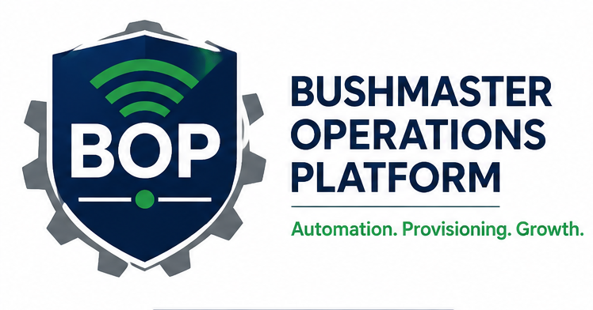
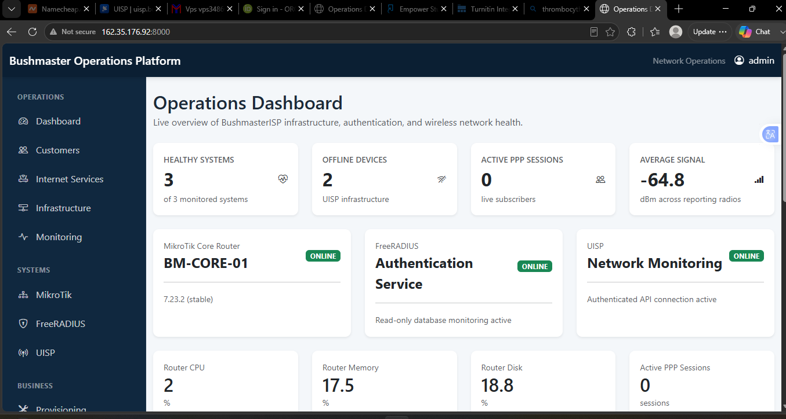
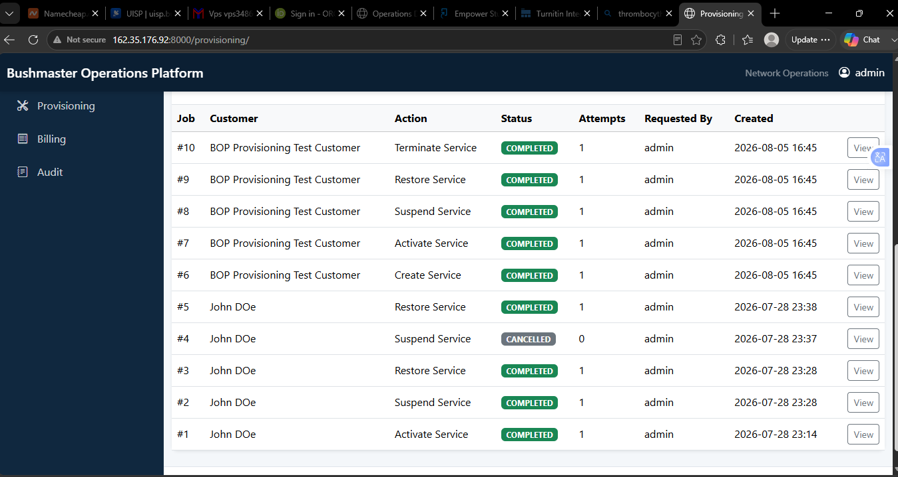
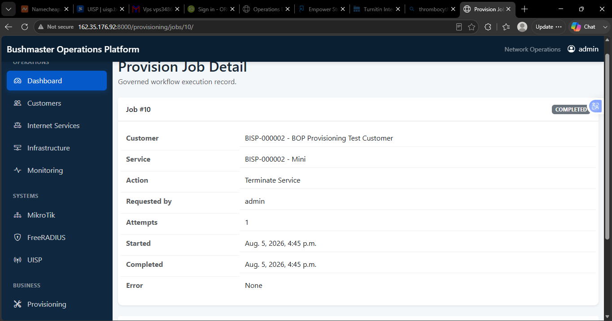

# Bushmaster Operations Platform (BOP)



**Automation. Provisioning. Growth.**

**Release stage:** controlled production and continuing v1 acceptance

**Documentation:** [Complete feature catalogue](docs/FEATURES.md) | [Architecture](docs/ARCHITECTURE.md) | [Current status](docs/PHASE_2_STATUS.md) | [Beta release notes](docs/V1_BETA_RELEASE.md) | [Roadmap](docs/ROADMAP.md) | [Platform screenshots](#platform-screenshots)

---

## Enterprise OSS/BSS platform

Bushmaster Operations Platform (BOP) is a commercial Operations Support System /
Business Support System (OSS/BSS) designed for wireless Internet service
providers. It brings subscriber lifecycle management, network provisioning,
authentication, monitoring, billing, customer self-service, communications and
infrastructure operations into one governed platform.

## Current status

**Updated 27 October 2026**

The current BOP milestone is deployed for controlled production use. It combines
the ISP operations console, guided subscriber provisioning, automated billing,
customer self-service, Flutterwave checkout, network visibility, deep-health
automation, supervised Ubiquiti firmware operations and the Jerou Hospital
identity, attendance and captive-access plane.

Production-impacting actions remain role-governed, independently switched,
audited and rollback-capable. This beta milestone is not the final general-
availability `v1.0.0` release.

See [Beta status](docs/PHASE_2_STATUS.md) for the activation boundary.

## Technology stack

- Python and Django
- MariaDB
- Bootstrap 5 and progressive JavaScript
- MikroTik RouterOS API
- FreeRADIUS authentication and accounting
- UISP monitoring and CRM import APIs
- Flutterwave v3 Standard payments
- Mapbox network mapping
- BulkSMSNigeria, Meta WhatsApp Cloud API and Brevo delivery adapters

## Implemented capabilities

- Customer, service-plan, Internet-service and subscriber-lifecycle management
- Guided provisioning with station identity, VLAN, PPPoE, access-binding and activation gates
- Governed provision, activate, suspend, restore and terminate workflows
- Cross-system verification, rollback evidence and immutable audit history
- MikroTik PPPoE, VLAN, session and subscriber-enforcement integration
- FreeRADIUS authentication, authorization and accounting integration
- UISP customer/service import, Ubiquiti monitoring and device-detail diagnostics
- Supervised firmware updates with explicit device selection and offline-device exclusion
- Thirty-minute deep-health checks, guarded self-healing and operator recommendations
- Automated billing cycles, customer-specific renewal days, invoice lifecycle and payment allocation
- Isolated customer portal with verified Flutterwave checkout and webhook processing
- Consent-aware SMS, WhatsApp and email reminders with a three-day grace policy
- Governed automatic suspension and restoration with independent safety interlocks
- Reconciliation, subscriber traffic correlation and UISP/Mapbox network mapping
- Surveillance probe registration, governed inventory and health reporting
- Jerou staff enrollment, policies, attendance, roster, captive access and device controls
- Role-governed Sentinel AI with typed, voice, learning and operational-assistance modes
- Lightweight Pegasus Sentinel Android companion with offline and USB-first operation
- Role-aware staff administration, secure customer access and complete audit evidence

The [complete feature catalogue](docs/FEATURES.md) separates production,
controlled and optional-provider capabilities.

## Safety and activation boundaries

- SMS and email delivery are independently switched, consent-aware and recorded
  in an idempotent notification ledger. WhatsApp remains an optional provider
  integration that requires approved Meta production configuration.
- Payment callbacks and webhooks are independently verified against Flutterwave
  before BOP allocates a payment.
- Subscriber suspension remains separate from notification delivery and requires
  an enforceable PPPoE access binding, completed grace period and final notice.
- Self-healing and firmware operations are scoped, audited and designed to fail
  closed when evidence is stale, a device is offline or provider policy conflicts.
- Jerou downstream wireless equipment must operate in access-point/bridge mode
  so BOP can identify and govern each client device.

## High-level architecture

```text
        Staff Operations Console       Isolated Customer Portal
                   |                              |
                   +--------------+---------------+
                                  |
                     Workflow and Billing Engine
                                  |
          +-----------------------+-----------------------+
          |                       |                       |
      MikroTik                FreeRADIUS                UISP
   access enforcement        AAA/accounting       device monitoring
                                  |
                 Flutterwave and notification providers
```

## Repository

The production source code is maintained in a private repository. This public
repository documents product architecture, engineering progress, capabilities
and the roadmap without publishing proprietary source code, credentials or
operational infrastructure details.

## Lead architect

Dr Ududua E. Omokaro, founder of El-Trivant Technologies Ltd., Nigeria.

## Platform screenshots

### Operations dashboard

Real-time operational visibility across the BOP infrastructure stack, including
MikroTik, FreeRADIUS, UISP, subscriber sessions, device health and network
performance indicators.



### Provisioning console

Centralized subscriber lifecycle management with governed service actions and
provision-job tracking.



### Provision job detail

Detailed execution evidence for governed provisioning workflows, including
operational traceability and workflow outcomes.


